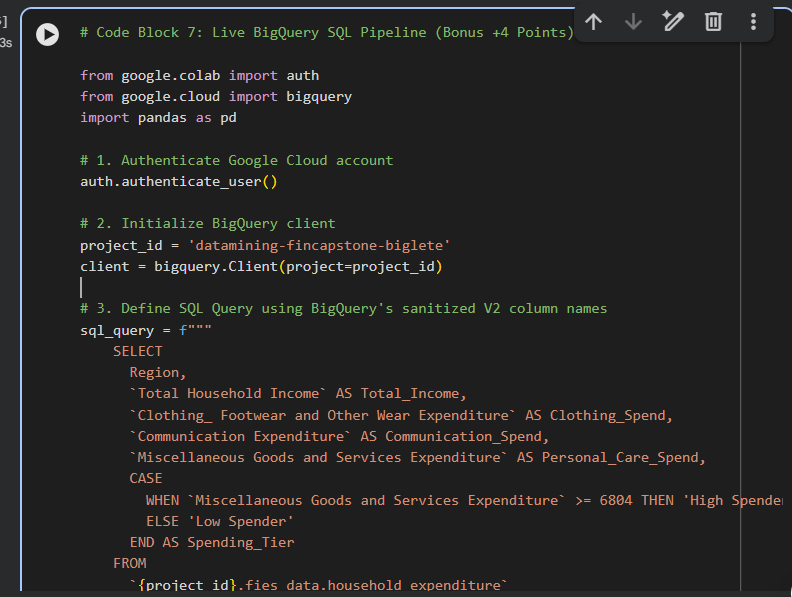
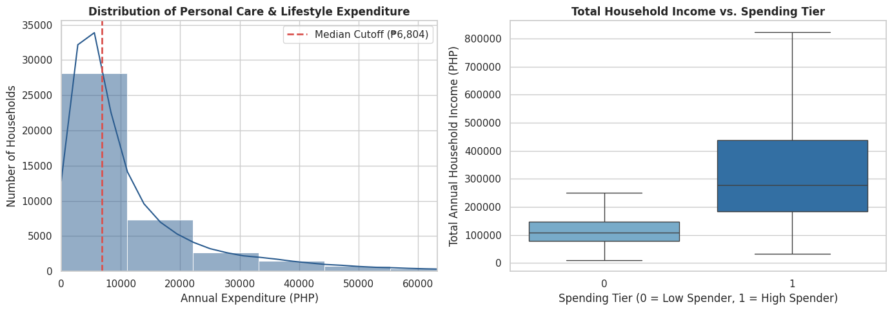
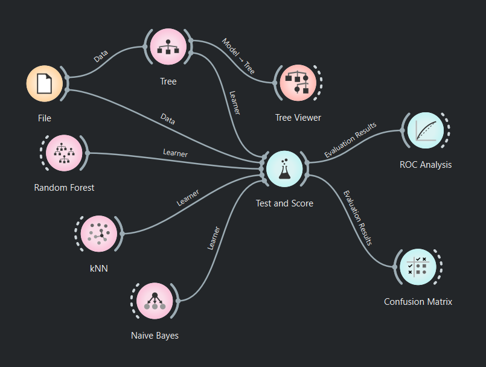
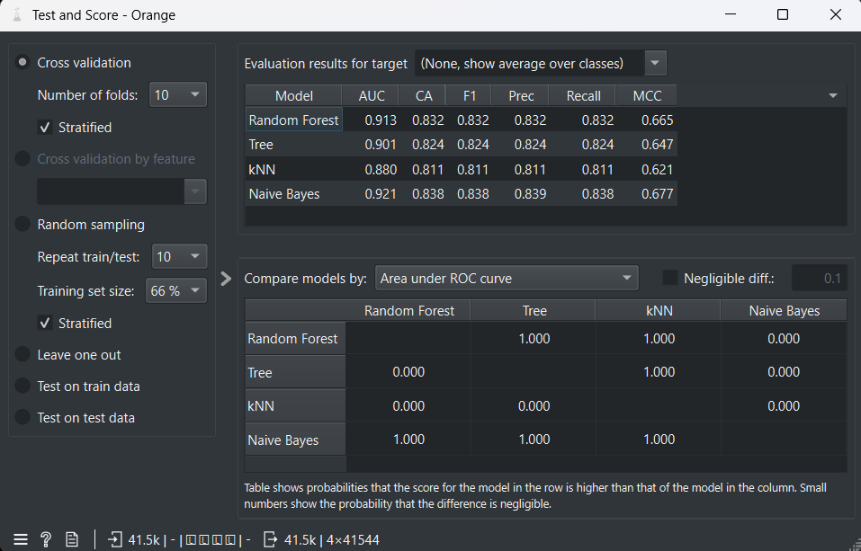
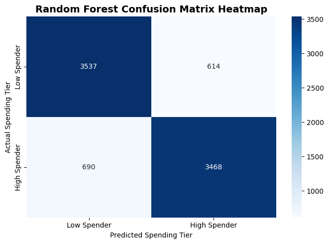
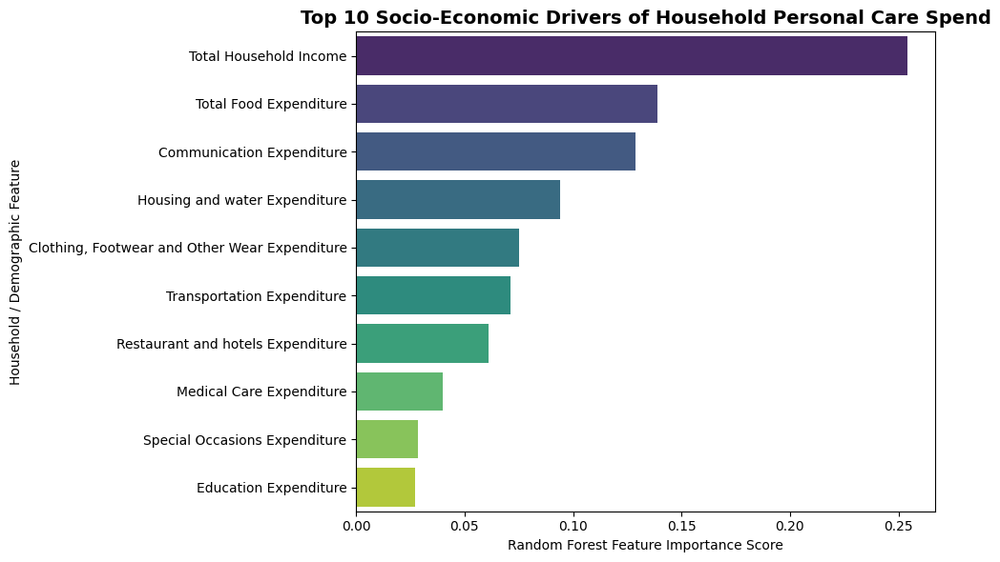
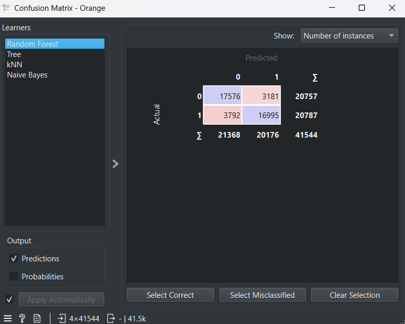
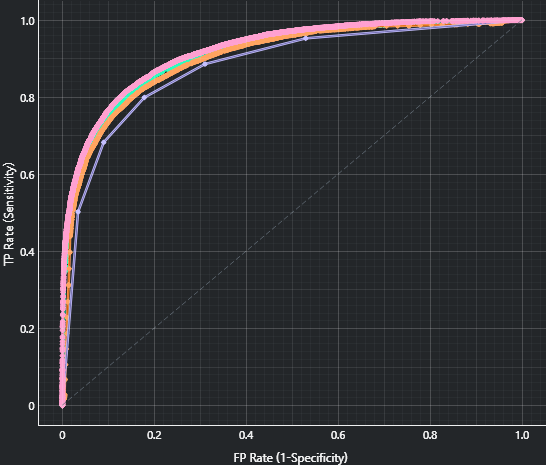
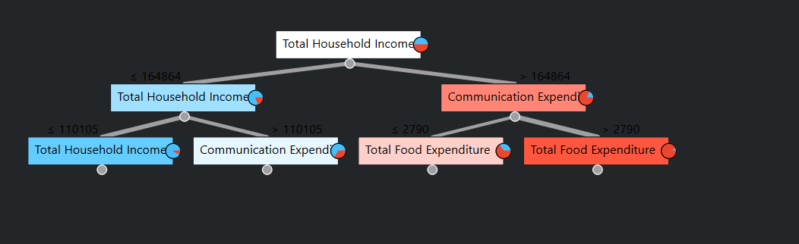

# Classifying Philippine Household Personal Care & Lifestyle Spending Tiers Using Machine Learning and Dual-Tool Data Mining Pipelines

**Author:** Trisha A. Biglete
**Program:** BS Computer Science — University of Perpetual Help System Laguna
**Course:** Data Mining Capstone

---

## Repository Structure

| File / Folder | Description |
|---|---|
| `DataMining_FinCapstone_Biglete.ipynb` | Main Jupyter Notebook — full Python pipeline (Google Colab) |
| `DataMining_Capstone.ows` | Orange Data Mining workflow file (visual dual-tool pipeline) |
| `Family Income and Expenditure.csv` | Raw PSA FIES dataset (41,544 households, 60 attributes) |
| `fies_cleaned_processed.csv` | Cleaned & feature-engineered dataset exported from the notebook (16 columns) |
| `Images/bigquery_pipeline.png` | Screenshot of the Google BigQuery SQL pipeline |
| `Images/eda_distributions.png` | EDA visualizations — expenditure distribution + income boxplot by tier |
| `Images/feature_importance.png` | Random Forest top-10 feature importance bar chart |
| `Images/confusion_matrix.png` | Python (scikit-learn) Random Forest confusion matrix heatmap |
| `Images/orange_workflow.png` | Orange Data Mining visual workflow screenshot |
| `Images/orange_test_and_score.png` | Orange Test and Score results (all four models, 10-fold CV) |
| `Images/orange_roc_analysis.png` | Orange ROC Analysis curves for all four models |
| `Images/orange_confusion_matrix.png` | Orange Confusion Matrix for the Random Forest model |
| `Images/orange_tree_viewer.png` | Orange Decision Tree Viewer — top-3-level tree structure |

---

## 1. Executive Summary & Problem Definition

### Problem Statement

Philippine households allocate a portion of their income to **Miscellaneous Goods and Services** — a category that encompasses personal care products, cosmetics, toiletries, and lifestyle expenditures. Despite representing a key market segment for fast-moving consumer goods (FMCG) and retail sectors, the socio-economic determinants that separate **High Spenders** from **Low Spenders** in this category remain poorly understood at the household level.

This project frames the problem as a **binary classification task**: given 15 socio-economic and demographic features drawn from the Philippine Statistics Authority (PSA) Family Income and Expenditure Survey (FIES), can a machine learning model accurately classify a household as a High or Low Personal Care & Lifestyle spender?

### Objectives

1. Engineer a balanced binary target variable (`Spending_Tier`) from the FIES Miscellaneous Goods and Services Expenditure column using a median split.
2. Build and compare four classification algorithms — Random Forest, Decision Tree, k-NN, and Naïve Bayes — across both a **Python scikit-learn pipeline** and an **Orange Data Mining visual workflow**.
3. Identify the top socio-economic drivers of personal care and lifestyle spending to yield actionable insights.

### Target Stakeholders

| Stakeholder | Relevance |
|---|---|
| FMCG & Retail Marketers | Segment targeting, product positioning, and regional campaign prioritization |
| Consumer Economists | Understanding discretionary spending behavior across income strata |
| Policy Researchers | Informing social protection design and household consumption monitoring |

### Context

The Philippines presents a distinctive household consumption landscape. The PSA FIES remains the primary national instrument for measuring income distribution and expenditure patterns across all 17 administrative regions (Philippine Statistics Authority, 2023). Albert et al. (2020) document significant income polarization across Philippine households, particularly in the context of COVID-19, underscoring how non-food expenditure — including personal care — is highly sensitive to household income and demographic structure.

---

## 2. Dataset & Cloud Data Engineering (BigQuery)

### Dataset: PSA Family Income and Expenditure Survey (FIES)

| Attribute | Value |
|---|---|
| **Source** | Philippine Statistics Authority (PSA) via Kaggle (Grosven, 2018) |
| **Records** | 41,544 household observations |
| **Original Features** | 60 attributes |
| **Coverage** | All 17 administrative regions of the Philippines |
| **Target Column** | `Miscellaneous Goods and Services Expenditure` (annual, in PHP) |

The dataset captures annual household-level expenditure across food, housing, transport, education, communication, healthcare, clothing, restaurant, and miscellaneous goods categories, alongside demographic information such as household head age, family size, and employment status.

### Google BigQuery Cloud Pipeline

To demonstrate cloud-scale data engineering, the FIES dataset was ingested into **Google BigQuery** under the project `datamining-fincapstone-biglete`, dataset `fies_data`, table `household_expenditure`. A SQL query was executed to extract key features and classify households in-cloud using a `CASE WHEN` expression mirroring the median-split threshold (₱6,804):

```sql
SELECT
    Region,
    `Total Household Income` AS Total_Income,
    `Clothing_ Footwear and Other Wear Expenditure` AS Clothing_Spend,
    `Communication Expenditure` AS Communication_Spend,
    `Miscellaneous Goods and Services Expenditure` AS Personal_Care_Spend,
    CASE
        WHEN `Miscellaneous Goods and Services Expenditure` >= 6804 THEN 'High Spender'
        ELSE 'Low Spender'
    END AS Spending_Tier
FROM
    `{project_id}.fies_data.household_expenditure`
```



The BigQuery pipeline confirms end-to-end cloud compatibility of the classification logic, enabling scalable real-time scoring of incoming FIES-structured household records.

---

## 3. Data Preprocessing & Exploratory Data Analysis (EDA)

### Missing Value Audit

A full audit of the 41,544-record dataset confirmed **zero missing values** across all 60 original attributes. No imputation was required.

```
--- Missing Values Audit ---
No missing values found!
```

### Feature Selection

Fifteen socio-economic and demographic features were selected from the 60 original attributes based on domain relevance to personal care and lifestyle spending:

| # | Feature | Type |
|---|---|---|
| 1 | Region | Categorical (17 regions) |
| 2 | Total Household Income | Continuous |
| 3 | Total Food Expenditure | Continuous |
| 4 | Clothing, Footwear and Other Wear Expenditure | Continuous |
| 5 | Education Expenditure | Continuous |
| 6 | Communication Expenditure | Continuous |
| 7 | Transportation Expenditure | Continuous |
| 8 | Restaurant and hotels Expenditure | Continuous |
| 9 | Special Occasions Expenditure | Continuous |
| 10 | Medical Care Expenditure | Continuous |
| 11 | Housing and water Expenditure | Continuous |
| 12 | Household Head Age | Continuous |
| 13 | Total Number of Family Members | Continuous |
| 14 | Members with age less than 5 year old | Continuous |
| 15 | Total number of family members employed | Continuous |

### Target Engineering: Spending_Tier

The binary target `Spending_Tier` was engineered using a **median split** on the `Miscellaneous Goods and Services Expenditure` column:

| Statistic | Value |
|---|---|
| Mean | ₱12,522.07 |
| Median (split threshold) | **₱6,804.00** |
| Std Dev | ₱17,547.03 |
| Min | ₱0.00 |
| Max | ₱553,560.00 |

```
Target Threshold (Median): ₱6,804.00
Selected 15 features successfully!

--- Target Class Balance ---
Spending_Tier
1    50.04%   ← High Spender (Miscellaneous spend ≥ ₱6,804)
0    49.96%   ← Low Spender  (Miscellaneous spend < ₱6,804)
```

The median split yields a **near-perfectly balanced** binary class distribution (50.04% High / 49.96% Low), which eliminates class-imbalance bias in model training and evaluation.

### Encoding & Scaling

- **One-Hot Encoding**: The categorical `Region` column (17 Philippine administrative regions) was one-hot encoded via `pd.get_dummies`, expanding the feature matrix from 15 to 30 columns.
- **Feature Scaling**: All continuous features were standardized using `StandardScaler` (Z-score normalization) to ensure distance-based algorithms (k-NN) and tree-based algorithms operate on a common scale.

```
Preprocessing Complete!
Features Shape after One-Hot Encoding: 41544 rows, 30 columns
```

### EDA Visualizations



The two-panel EDA figure reveals critical distributional properties:

**Left Panel — Distribution of Personal Care & Lifestyle Expenditure:**
The expenditure distribution is **strongly right-skewed**, with the vast majority of households spending under ₱20,000 annually. The distribution peaks sharply near ₱0–₱5,000, with a long tail extending to ₱553,560. The red dashed line at ₱6,804 (the median cutoff) sits near the first major inflection point of the distribution, confirming it is a sensible and statistically justified split threshold.

**Right Panel — Total Household Income vs. Spending Tier:**
The boxplot demonstrates a **clear income stratification** between tiers. High Spender households (Tier 1) show markedly higher median annual household income (~₱290,000) compared to Low Spenders (Tier 0, median ~₱110,000). The interquartile range of High Spenders also extends much further (~₱200,000–₱430,000 vs. ~₱70,000–₱140,000), confirming that **household income is a strong discriminating signal** for personal care spending tier classification.

---

## 4. Data Mining Methodology & Dual-Tool Implementation

### Classification Algorithms

Four classification algorithms were evaluated, covering the major paradigms of supervised learning (Han, Kamber, & Pei, 2011):

| Algorithm | Paradigm | Key Hyperparameters Used |
|---|---|---|
| **Random Forest** | Ensemble (bagged decision trees) | `n_estimators=100`, `max_depth=12`, `random_state=42` |
| **Decision Tree** | Rule-based / tree induction | `max_depth=10`, `random_state=42` |
| **k-Nearest Neighbors (k-NN)** | Instance-based / lazy learning | `n_neighbors=7` |
| **Naïve Bayes** | Probabilistic / generative | `GaussianNB` (default) |

### Python scikit-learn Pipeline (Google Colab)

The Python pipeline follows a standard supervised learning workflow:

1. **Train-Test Split**: 80% training / 20% test, **stratified** by `Spending_Tier` to preserve class balance, `random_state=42` for reproducibility.
2. **Model Training**: Each model was fit on the scaled, one-hot-encoded training set.
3. **Evaluation**: Accuracy, Precision, Recall, and F1-Score computed on the held-out 20% test set (8,309 records).

### Orange Data Mining Visual Workflow

The same classification task was replicated in **Orange Data Mining** using the `.ows` workflow file (`DataMining_Capstone.ows`). This provides a no-code, GUI-driven validation of the Python results using **10-fold stratified cross-validation** on the full 41,544-record dataset.



The Orange workflow consists of eight nodes connected as follows:

- **File** node → loads `fies_cleaned_processed.csv` (41,544 × 16)
- **File** → feeds data into **Test and Score** (CV evaluation hub) and also directly into **Tree** (for tree model construction)
- **Random Forest**, **Tree**, **kNN**, **Naive Bayes** → each passes its `Learner` output to **Test and Score**
- **Tree** → passes its `Model` to **Tree Viewer** (interactive tree visualization)
- **Test and Score** → `Evaluation Results` feed both **ROC Analysis** and **Confusion Matrix**

The Orange workflow uses:
- **Random Forest**: `min_samples_split=5`, `max_depth` unconstrained, `n_estimators=10`
- **Tree**: `max_depth=8`, `min_leaf=2`, `min_internal=100`, `sufficient_majority=95%`
- **kNN**: `n_neighbors=5`, Euclidean distance
- **Naive Bayes**: default Gaussian Naive Bayes

---

## 5. Model Evaluation & Comparative Results

### Python scikit-learn Results (80/20 Stratified Split — 8,309 Test Records)

```
=== MODEL PERFORMANCE COMPARISON ===
        Model  Accuracy  Precision   Recall  F1-Score
Random Forest  0.843062   0.849584 0.834055  0.841748
Decision Tree  0.812733   0.813645 0.811688  0.812666
         k-NN  0.810687   0.847540 0.758057  0.800305
  Naïve Bayes  0.770490   0.889581 0.618086  0.729388
```

| Model | Accuracy | Precision | Recall | F1-Score |
|---|---|---|---|---|
| **Random Forest** | **84.31%** | **84.96%** | **83.41%** | **84.17%** |
| Decision Tree | 81.27% | 81.36% | 81.17% | 81.27% |
| k-NN | 81.07% | 84.75% | 75.81% | 80.03% |
| Naïve Bayes | 77.05% | 88.96% | 61.81% | 72.94% |

### Orange Data Mining Results (10-Fold Stratified Cross-Validation — 41,544 Records)

The Orange Test and Score widget evaluated all four models using 10-fold stratified cross-validation on the complete dataset, yielding more stable population-level estimates than the hold-out split.



| Model | AUC | CA (Accuracy) | F1 | Precision | Recall | MCC |
|---|---|---|---|---|---|---|
| **Naive Bayes** | **0.921** | 0.838 | 0.838 | 0.839 | 0.838 | 0.677 |
| **Random Forest** | 0.913 | **0.832** | **0.832** | **0.832** | **0.832** | 0.665 |
| Tree | 0.901 | 0.824 | 0.824 | 0.824 | 0.824 | 0.647 |
| kNN | 0.880 | 0.811 | 0.811 | 0.811 | 0.811 | 0.621 |

**Statistical comparison (AUC-based pairwise probabilities):**
- Naïve Bayes vs. Random Forest: p = 1.000 (Naïve Bayes significantly higher AUC)
- Random Forest vs. Tree: p = 1.000
- Random Forest vs. kNN: p = 1.000
- Naïve Bayes vs. kNN: p = 1.000

### Interpretation: Python vs. Orange Results

The divergence between tools is **expected and methodologically meaningful**:

| Aspect | Python (scikit-learn) | Orange (10-fold CV) |
|---|---|---|
| Evaluation strategy | Single 80/20 hold-out split | 10-fold stratified CV |
| Data used | 33,235 train / 8,309 test | Full 41,544 (CV rotations) |
| RF hyperparameters | 100 trees, max_depth=12 | 10 trees, min_samples_split=5 |
| Naïve Bayes result | Lowest F1 (72.94%) | Highest AUC (0.921) |

The Naïve Bayes model achieves the highest AUC (0.921) in Orange's CV evaluation, indicating excellent **rank-ordering / discrimination ability**, but its lower Recall in the Python pipeline (61.81%) reflects a conservative decision boundary under the 80/20 split. Random Forest delivers the most **balanced and consistent** performance across both tools — high accuracy, well-balanced precision/recall, and stable F1 — making it the **recommended production model**.

---

## 6. Visual Analysis of Results

### Random Forest Confusion Matrix (Python — scikit-learn)



The heatmap shows the classification breakdown on the 20% held-out test set (8,309 records):

| | Predicted: Low Spender | Predicted: High Spender |
|---|---|---|
| **Actual: Low Spender** | **3,537** (TN) | 614 (FP) |
| **Actual: High Spender** | 690 (FN) | **3,468** (TP) |

- **True Positives (TP)**: 3,468 High Spender households correctly classified
- **True Negatives (TN)**: 3,537 Low Spender households correctly classified
- **False Positives (FP)**: 614 Low Spenders incorrectly predicted as High Spenders
- **False Negatives (FN)**: 690 High Spenders incorrectly predicted as Low Spenders
- **Overall Accuracy**: (3,537 + 3,468) / 8,309 = **84.3%**

The model is well-balanced, with comparable false positive (614) and false negative (690) counts, indicating no systematic directional bias. For FMCG targeting use cases, the low false negative rate (not missing actual High Spenders) is particularly valuable.

### Random Forest Feature Importance (Python — scikit-learn)



The Random Forest model identifies the top-10 socio-economic drivers of household personal care spending tier:

| Rank | Feature | Importance Score (approx.) |
|---|---|---|
| 1 | Total Household Income | ~0.26 |
| 2 | Total Food Expenditure | ~0.14 |
| 3 | Communication Expenditure | ~0.13 |
| 4 | Housing and water Expenditure | ~0.10 |
| 5 | Clothing, Footwear and Other Wear Expenditure | ~0.08 |
| 6 | Transportation Expenditure | ~0.07 |
| 7 | Restaurant and hotels Expenditure | ~0.06 |
| 8 | Medical Care Expenditure | ~0.04 |
| 9 | Special Occasions Expenditure | ~0.03 |
| 10 | Education Expenditure | ~0.03 |

**Total Household Income** is by far the dominant predictor (importance ~0.26), accounting for more than double the influence of any single other feature. This confirms the boxplot finding from EDA that income level is the primary determinant of personal care spending tier. **Communication Expenditure** ranks third, suggesting that households investing in connectivity (mobile data, internet plans) tend to spend more on personal care — a proxy for urban lifestyle orientation.

### Orange Confusion Matrix (10-Fold CV — Random Forest)



Evaluated on the full 41,544-record dataset via 10-fold cross-validation, the Orange Random Forest confusion matrix shows:

| | Predicted: 0 (Low) | Predicted: 1 (High) | Row Total |
|---|---|---|---|
| **Actual: 0 (Low)** | **17,576** | 3,181 | 20,757 |
| **Actual: 1 (High)** | 3,792 | **16,995** | 20,787 |
| **Col Total** | 21,368 | 20,176 | **41,544** |

- **Overall Accuracy**: (17,576 + 16,995) / 41,544 = **83.2%** (consistent with Orange's CA = 0.832)
- Both classes are classified with similar error rates (3,181 FP vs. 3,792 FN), confirming balanced performance on the full population.

### Orange ROC Analysis



The ROC curves for all four models are plotted simultaneously. All curves sit well above the diagonal random-classifier baseline, with **Naïve Bayes** (AUC = 0.921) and **Random Forest** (AUC = 0.913) tracing the highest curves. The steep initial rise in all curves indicates strong discrimination ability at low false positive rates, which is critical for precision-targeted marketing applications.

### Orange Decision Tree Viewer



The Orange Tree Viewer reveals the top decision logic of the Decision Tree model (max_depth=8). The root-level and first two branching levels demonstrate:

**Root Node**: `Total Household Income`
- **Left branch** (≤ ₱164,864): → Split again on `Total Household Income` (≤ ₱110,105)
  - **Far-left** (≤ ₱110,105): → `Total Household Income` (further split, blue-dominant = Low Spender)
  - **Left-center** (> ₱110,105): → `Communication Expenditure` (mixed, slightly blue)
- **Right branch** (> ₱164,864): → Split on `Communication Expenditure` (≤ ₱2,790 vs. > ₱2,790)
  - **Right-center** (≤ ₱2,790): → `Total Food Expenditure` (orange-dominant = High Spender)
  - **Far-right** (> ₱2,790): → `Total Food Expenditure` (orange-dominant = High Spender)

This tree structure independently confirms the feature importance ranking: **Total Household Income** is the most discriminative single feature, followed by **Communication Expenditure** and **Total Food Expenditure** as secondary splits. High-income households (> ₱164,864/year) with higher communication spending are classified as High Spenders with high confidence.

---

## 7. Key Insights, Limitations & Recommendations

### Top Spending Drivers

The convergent findings from both Python feature importance analysis and the Orange Decision Tree structure point to a consistent hierarchy of spending drivers:

1. **Total Household Income** — The single strongest predictor. Personal care and lifestyle spending is fundamentally income-constrained; households below ~₱110,000 annual income are predominantly Low Spenders.
2. **Total Food Expenditure** — Reflects overall household consumption scale. Households that spend more on food tend to spend more across all discretionary categories.
3. **Communication Expenditure** — A proxy for urban connectivity and digital lifestyle. High communication spenders skew toward High personal care spending tier.
4. **Housing and water Expenditure** — Reflects household quality and urban residence, which correlates with access to personal care retail channels.
5. **Clothing, Footwear and Other Wear Expenditure** — Directly captures fashion and appearance investment, a natural co-predictor of personal care spending.

### Actionable Recommendations for Stakeholders

**FMCG & Retail Marketers:**
- Prioritize households earning above ₱164,864 annually (the Decision Tree's first income split) as the primary High Spender segment for premium personal care product marketing.
- Target high communication-spend regions (proxied by communication expenditure > ₱2,790) for digital/mobile-first marketing campaigns.
- Regional one-hot encoding features (though not in the top-10 importances) can be used for geographic market prioritization.

**Consumer Economists & Policy Researchers:**
- The near-perfect class balance at the ₱6,804 median threshold suggests that personal care spending is a genuinely bimodal distribution at the population level — not a niche luxury category.
- Albert et al. (2020) note that non-food expenditure is highly vulnerable to income shocks. The strong income dependency found here (~0.26 importance) supports this finding and suggests personal care spending should be monitored as an indicator of household welfare.

### Methodological Limitations

| Limitation | Implication |
|---|---|
| **Cross-sectional survey data** | FIES captures a single point in time; spending patterns may differ across years and economic cycles. |
| **Self-reported expenditure** | Survey-based income and expenditure data are subject to recall bias and underreporting, particularly for high-income households. |
| **Regional aggregation** | One-hot encoded Region captures administrative boundaries, not urban/rural granularity within regions. |
| **Target variable proxy** | "Miscellaneous Goods and Services Expenditure" is a proxy for personal care; it includes non-personal-care items not disaggregated in the FIES. |
| **Temporal generalizability** | The dataset (Grosven, 2018 Kaggle release) reflects a specific FIES survey year; model performance may degrade on more recent cohorts. |

---

## 8. References

Albert, J. R. G., Abrigo, M. R. M., Quimba, F. M. A., & Vizmanos, J. F. V. (2020). *Poverty, the middle class, and income distribution amid COVID-19* (PIDS Discussion Paper Series No. 2020-22). Philippine Institute for Development Studies. https://pidswebs.pids.gov.ph/CDN/PUBLICATIONS/pidsdps2022.pdf

Grosven, P. (2018). *Filipino family income and expenditure* [Data set]. Kaggle. https://www.kaggle.com/datasets/grosvenpaul/family-income-and-expenditure

Han, J., Kamber, M., & Pei, J. (2011). *Data mining: Concepts and techniques* (3rd ed.). Morgan Kaufmann. https://doi.org/10.1016/C2009-0-61819-5

Philippine Statistics Authority. (2023). *Family Income and Expenditure Survey (FIES)*. https://psa.gov.ph/statistics/income-expenditure/fies
